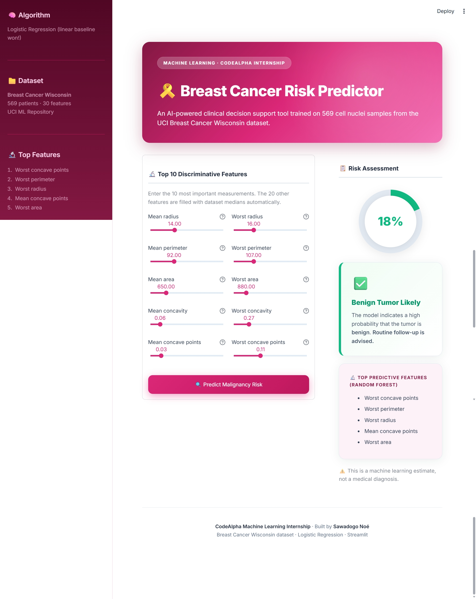
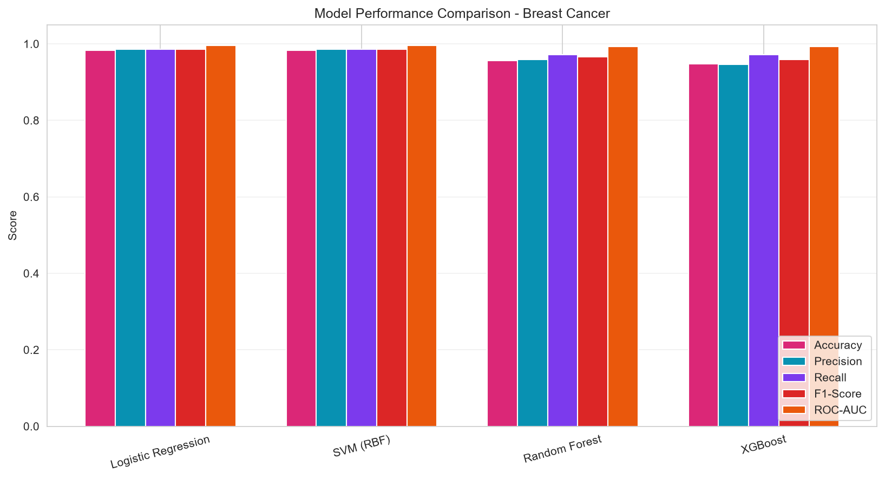
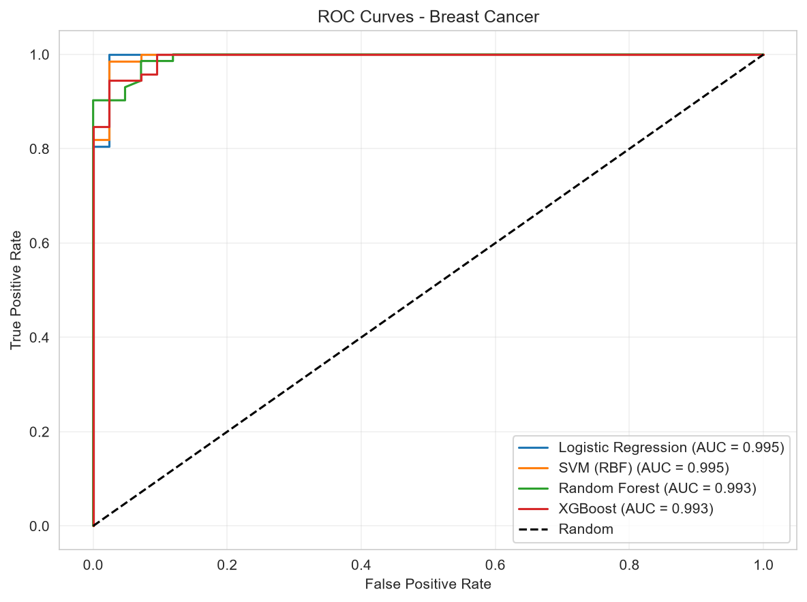
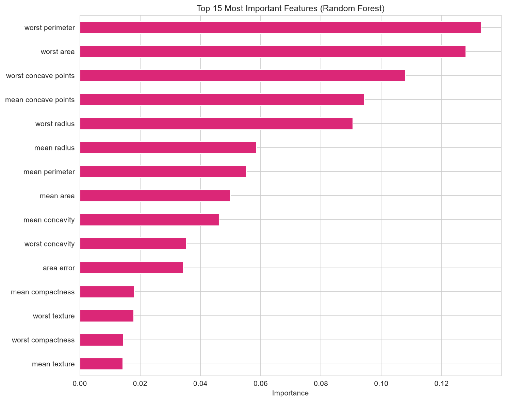

@'
# 🎗️ Breast Cancer Prediction

> An end-to-end Machine Learning project that predicts breast cancer malignancy from cell nuclei measurements — with a live interactive demo.

---

## 📸 App Preview

---

## 🚀 Live Demo

**[Try the interactive app here](https://sawadogo-breast-cancer.streamlit.app)**

Enter 10 key cell nuclei measurements and get an instant malignancy risk assessment powered by a Logistic Regression model.

---

## 📖 Overview

This project was developed as part of the **Machine Learning Internship at [CodeAlpha](https://www.codealpha.tech)**.

The goal is to predict whether a breast tumor is **malignant** or **benign** from features computed on digitized images of a fine needle aspirate (FNA) of a breast mass — a diagnostic task where early detection greatly improves outcomes.

Four classification models were trained and compared:
- **Logistic Regression**
- **Support Vector Machine (RBF kernel)**
- **Random Forest**
- **XGBoost**

---

## 📊 Results

| Model | Accuracy | Precision | Recall | F1-Score | ROC-AUC |
|---|---|---|---|---|---|
| **Logistic Regression** | **0.9825** | **0.9861** | **0.9861** | **0.9861** | **0.9954** |
| SVM (RBF) | 0.9825 | 0.9861 | 0.9861 | 0.9861 | 0.9950 |
| Random Forest | 0.9561 | 0.9589 | 0.9722 | 0.9655 | 0.9932 |
| XGBoost | 0.9474 | 0.9459 | 0.9722 | 0.9589 | 0.9927 |

**Logistic Regression** was selected as the final model — 98.25% accuracy and 0.9954 ROC-AUC, matching or beating the more complex models. This suggests the classes are close to linearly separable in this feature space.

### Key Insights — Feature Importance

| Feature | Meaning |
|---|---|
| **Worst concave points** | Mean of the 3 largest values of the number of concave portions of the contour |
| **Worst perimeter** | Mean of the 3 largest nucleus perimeters |
| **Worst radius** | Mean of the 3 largest nucleus radii |
| **Mean concave points** | Average number of concave portions of the contour |
| **Worst area** | Mean of the 3 largest nucleus areas |

Larger nuclei with irregular, concave contours are associated with malignancy — consistent with these results.

---

## 🖼️ Visualizations

### Model comparison

### ROC curves

### Feature importance

---

## 📁 Dataset

**Breast Cancer Wisconsin (Diagnostic)** — UCI ML Repository, loaded via scikit-learn.

- **569 patients** with FNA samples
- **30 numerical features**: radius, texture, perimeter, area, smoothness, compactness, concavity, concave points, symmetry, fractal dimension (mean, standard error, worst)
- **Target**: binary (0 = malignant, 1 = benign)
- **Class distribution**: 62.7% benign / 37.3% malignant
- **Zero missing values**

---

## 🛠️ Tech Stack

| Layer | Tools |
|---|---|
| **Language** | Python 3.13 |
| **ML** | scikit-learn, XGBoost |
| **Data** | pandas, NumPy |
| **Visualization** | Matplotlib, Seaborn |
| **Web app** | Streamlit |
| **Deployment** | Streamlit Community Cloud |

---

## 📂 Project Structure

CodeAlpha_BreastCancerPrediction/
- .streamlit/config.toml
- images/ (app_preview.png, model_comparison.png, roc_curves.png, feature_importance.png)
- app.py
- breast_cancer_prediction.ipynb
- model.pkl, scaler.pkl, features.pkl, medians.pkl
- results.csv
- requirements.txt
- README.md

---

## 🚀 Run Locally

git clone https://github.com/Sawadogo-cmk/CodeAlpha_BreastCancerPrediction.git
cd CodeAlpha_BreastCancerPrediction
python -m venv .venv
.venv\Scripts\activate
pip install -r requirements.txt
streamlit run app.py

The app opens at http://localhost:8501.

---

## 🧠 Model Pipeline

1. **Data loading**: sklearn.datasets.load_breast_cancer() — no download required
2. **Split**: 80% train / 20% test (stratified)
3. **Scaling**: StandardScaler fit on training data only
4. **Training**: 4 models compared on 5 metrics
5. **Selection**: Logistic Regression (best ROC-AUC, tied best F1)
6. **Deployment**: serialized with joblib, served via Streamlit

---

## ⚠️ Disclaimer

This is a machine learning demonstration project, not a medical device. Predictions should never replace professional medical advice. Always consult a qualified oncologist for clinical decisions.

---

## 👨‍💻 Author

**Sawadogo Noé** — Machine Learning Intern at [CodeAlpha](https://www.codealpha.tech)

- GitHub: [@Sawadogo-cmk](https://github.com/Sawadogo-cmk)
- Live demo: [sawadogo-breast-cancer.streamlit.app](https://sawadogo-breast-cancer.streamlit.app)

---

## 📜 License

MIT License — see the [LICENSE](LICENSE) file for details.
'@ | Set-Content -Path README.md -Encoding UTF8
